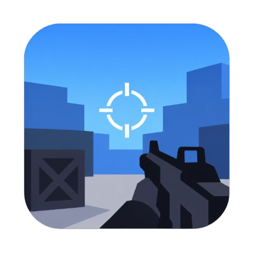

<div align="center">
  

  <h1>Project Rushkill</h1>

  <p><em>Fast-paced 3D browser FPS with arcade-style movement</em></p>

  <p>
    <a href="https://project-rushkill.fly.dev/" target="_blank" rel="noopener noreferrer"><strong>▶ Play it live</strong></a>
  </p>
</div>

A single-player arena FPS built with React, Three.js, and TypeScript. Fight AI bots on a
Hijacked-inspired yacht map with a compact arsenal and movement tech borrowed from arena shooters.

## Features

- **4 weapons** across 4 categories (AR, SMG, Shotgun, Sniper) with distinct ballistics, recoil
  profiles, and range falloff
- **Arcade-style movement**: bunny-hop, slide-hop, air-strafe, coyote time and jump buffering
- **Advanced bot AI**: 6 personalities × 4 difficulties, with a perception system (FOV, line of
  sight, gunfire and footstep hearing) plus cover seeking
- **Procedural audio** via the Web Audio API — zero external audio files
- **Score streaks**: Double Kill → Bloodthirsty → Merciless → Relentless
- **Custom match config**: time limit, score limit, bot count, bot difficulty, weapon category filters
- **LAN multiplayer** (optional): host or join a room over WebSocket

## Arsenal

| Weapon | Category | Damage | Fire rate | Magazine |
|--------|----------|--------|-----------|----------|
| AR (`mcw`) | Assault Rifle | 28 | 715 RPM | 30 |
| SMG (`rival_9`) | SMG | 23 | 910 RPM | **45** |
| Shotgun (`lockwood_680`) | Shotgun | 18 × 8 pellets | 80 RPM | 6 |
| Sniper (`longbow`) | Sniper | 110 | 85 RPM | 7 |

Shotguns deal no damage past 20 m; sniper damage falls off 20% per 30 m beyond the first.

## Run Locally

**Prerequisites:** Node.js 18+ (or Bun)

```bash
# Install dependencies
npm install

# Start the dev server on http://localhost:3000
npm run dev
```

To play with others on the same network, start the WebSocket server in a second terminal and use
the in-game **Multiplayer → Host** screen:

```bash
npm run dev:server
```

## Controls

| Action | Key |
|--------|-----|
| Move | WASD |
| Jump | Space |
| Slide | Shift / C (while sprinting) |
| Aim (ADS) | Right Click |
| Fire | Left Click |
| Reload | R |
| Pause | Esc / P |
| Mute | M |

## Tech Stack

- **React 19** + **TypeScript** (UI)
- **Three.js** (WebGL rendering)
- **Vite** (build tool)
- **Tailwind CSS v4** (styling)
- **Web Audio API** (procedural sound synthesis)
- **ws** (LAN multiplayer transport)
- **Jest** (unit tests) · **Fly.io** (hosting)

## Project Structure

```
src/
  game/         Engine, physics, weapons, bot AI, maps, audio, networking
  components/   React UI — HUD, menus, loadout, multiplayer
  App.tsx       Screen flow and match state
server/         Optional WebSocket server for LAN multiplayer
scripts/        Regression harnesses
public/         Static assets (logo / favicon)
```

## Scripts

| Command | Description |
|---------|-------------|
| `npm run dev` | Dev server on port 3000 |
| `npm run dev:lan` | Dev server exposed on the LAN |
| `npm run dev:server` | WebSocket server for multiplayer |
| `npm run build` | Production build into `dist/` |
| `npm run preview` | Preview the production build |
| `npm run lint` | Type-check with `tsc --noEmit` |
| `npm test` | Jest unit tests |

Physics regression harness — verifies every stair on the yacht is climbable and that no collision
correction can eject the player into the ocean:

```bash
node scripts/verify-stairs.ts
```

## Deployment

The game is a static bundle served from Fly.io:

```bash
npm run build
flyctl deploy --app project-rushkill
```

Live at **https://project-rushkill.fly.dev/**. Machines scale to zero when idle, so the first
request after a quiet period may take a few seconds to cold-start.

## Glossary

See [GLOSSARY.md](GLOSSARY.md) for the project's domain vocabulary (movement tech, bot states,
ballistics, match flow).
